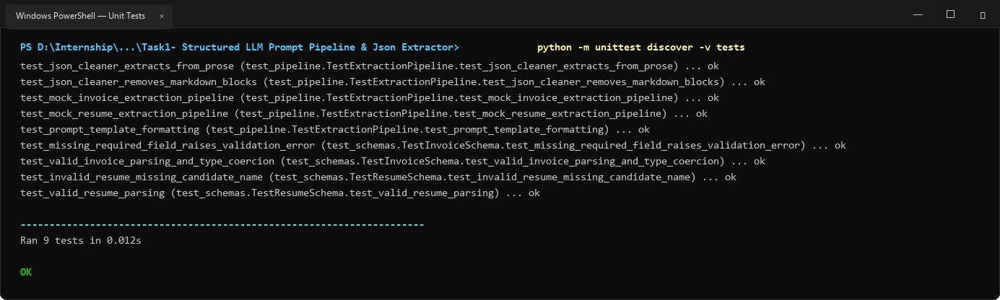
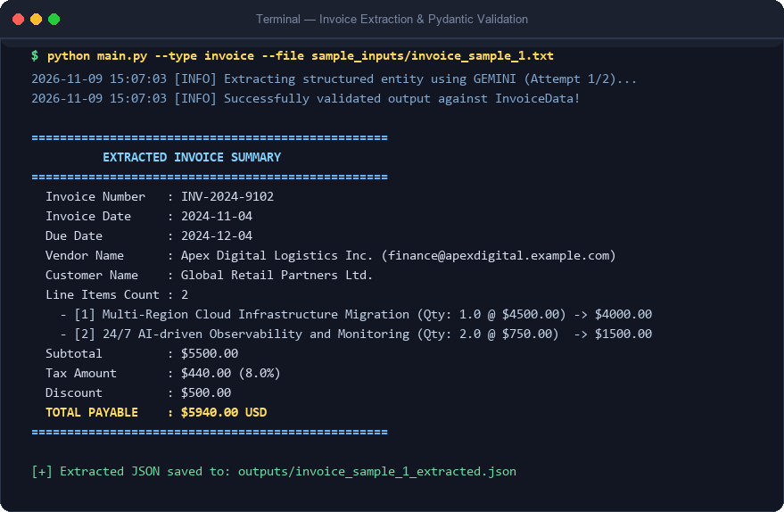
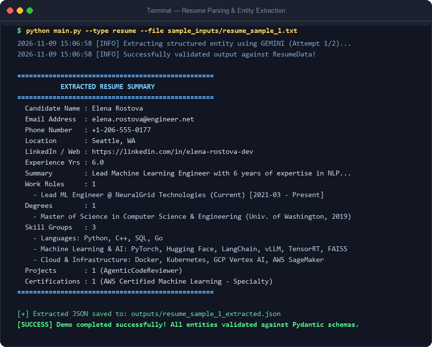

# Task 1: Structured LLM Prompt Pipeline & JSON Extractor
**Author:** Muhammad Raihan Molla  
**Internship Project:** Datheon Python + Generative AI & LangChain

A Python pipeline for extracting strictly validated structured data from complex unstructured documents (Invoices and Resumes) using **Google Gemini** or **OpenAI**, parameterized prompt templates with few-shot exemplars, and **Pydantic v2** validation.

---

## 📌 Problem Statement & Requirements
> **Objective**: Connect Python to Google Gemini or OpenAI API, build parameterized prompt templates, and enforce strictly validated JSON outputs for invoice or resume analysis.
>
> **Deliverable**: An executable script parsing complex unstructured text documents into validated JSON schemas.

---

## 🌟 Key Features

1. **Multi-Provider LLM Integration**:
   - Supports **Google Gemini** (via both the official modern `google-genai` SDK and `google-generativeai`).
   - Supports **OpenAI** (via `openai` Python SDK with native JSON mode `response_format={"type": "json_object"}`).
   - Automatic fallback: If one provider key is not configured, it can automatically leverage the alternate provider or fallback to offline mode for local testing.

2. **Parameterized Prompt Engineering & Few-Shot Learning**:
   - Formulates prompts with injected Pydantic JSON schemas (`model_json_schema()`).
   - Dynamically injects high-quality few-shot exemplars for both Invoices and Resumes to anchor the model's reasoning and ensure zero schema drift.

3. **Strict Pydantic v2 Validation & Sanitization**:
   - **`InvoiceData`**: Validates vendor details, customer information, line items (quantity, unit price, discounts, computed totals), subtotal, tax rate, discount, shipping, payment terms, and bank details.
   - **`ResumeData`**: Validates candidate contact info, career summary, years of experience, work history (roles, achievements, tech stacks, current status flags), education, categorized skills, projects, certifications, and languages.
   - Built-in field validators sanitize messy real-world strings (e.g., parsing `"$1,250.00"` -> `1250.0`).

4. **Self-Healing Error Recovery**:
   - Pipeline intercepts schema validation failures or JSON parsing errors, feeds the specific error back to the LLM in an automated retry loop, and enforces valid output.

5. **Complete Test Suite**:
   - 9 automated unit and integration tests covering schema validation, edge case type coercion, prompt generation, JSON block extraction, and pipeline runs.

---

## 📁 Directory Structure

```text
Task1- Structured LLM Prompt Pipeline & Json Extractor/
│
├── schemas/
│   ├── __init__.py
│   ├── invoice_schema.py        # Pydantic v2 model for invoice extraction
│   └── resume_schema.py         # Pydantic v2 model for resume extraction
│
├── prompts/
│   ├── __init__.py
│   ├── few_shot_examples.py     # Few-shot exemplars with ground-truth JSON
│   └── templates.py             # Parameterized prompt templates
│
├── extractors/
│   ├── __init__.py
│   ├── llm_client.py            # Unified Gemini / OpenAI / Offline LLM Client
│   └── pipeline.py              # Extraction pipeline with retry & validation
│
├── sample_inputs/
│   ├── invoice_sample_1.txt     # Cloud migration service invoice email
│   ├── invoice_sample_2.txt     # CyberGuard defense systems commercial invoice
│   ├── resume_sample_1.txt      # Lead Machine Learning Engineer resume
│   └── resume_sample_2.txt      # Senior Full-Stack & Systems Engineer resume
│
├── outputs/                     # Extracted, validated JSON outputs
│   ├── invoice_sample_1_extracted.json
│   └── resume_sample_1_extracted.json
│
├── tests/
│   ├── __init__.py
│   ├── test_schemas.py          # Unit tests for schema models
│   └── test_pipeline.py         # Unit tests for pipeline & cleaners
│
├── main.py                      # CLI runner & demonstration suite
├── requirements.txt             # Project dependencies
├── .env.example                 # Environment configuration template
└── README.md                    # Project documentation
```

---

## 🚀 Setup & Installation

### 1. Prerequisites
- Python 3.10+ (tested on Python 3.14)
- Pip package manager

### 2. Install Dependencies
```bash
pip install -r requirements.txt
```

### 3. Configure API Keys
Copy `.env.example` to `.env` and insert your API key(s):
```bash
cp .env.example .env
```
Edit `.env`:
```env
# Google Gemini API Key (https://aistudio.google.com/)
GEMINI_API_KEY=your_actual_gemini_api_key

# Or OpenAI API Key (https://platform.openai.com/)
OPENAI_API_KEY=your_actual_openai_api_key

# Default provider choice: "gemini" or "openai"
DEFAULT_LLM_PROVIDER=gemini
```
*(Note: If no API key is provided, the pipeline gracefully runs in mock/test mode so you can test all pipeline logic without external dependencies).*

---

## 💻 Usage & CLI Guide

Navigate to the project folder:
```bash
cd "Task1- Structured LLM Prompt Pipeline & Json Extractor"
```

### 1. Run Complete Automated Demo
Runs extraction on both invoice and resume samples, prints summaries to the terminal, and writes validated JSON to `outputs/`:
```bash
python main.py --demo
```

### 2. Parse an Invoice Document
```bash
python main.py --type invoice --file sample_inputs/invoice_sample_1.txt
```

### 3. Parse a Resume Document
```bash
python main.py --type resume --file sample_inputs/resume_sample_1.txt
```

### 4. Select a Specific LLM Provider
Override the default provider using `--provider`:
```bash
python main.py --type invoice --file sample_inputs/invoice_sample_2.txt --provider gemini
# or
python main.py --type invoice --file sample_inputs/invoice_sample_2.txt --provider openai
```

### 5. Disable Few-Shot Prompting (Zero-Shot Mode)
To test extraction without few-shot examples:
```bash
python main.py --type resume --file sample_inputs/resume_sample_2.txt --no-few-shot
```

### 6. Custom Output File Destination
```bash
python main.py --type invoice --file sample_inputs/invoice_sample_1.txt --output ./outputs/custom_result.json
```

---

## 📸 Execution Screenshots & Test Results

### 1. Automated Test Suite (All 9 Unit Tests Passing)


### 2. Complex Unstructured Invoice Extraction & Pydantic Validation


### 3. Comprehensive Resume / CV Extraction


---

## 🧪 Running Unit Tests

Run the full automated test suite:
```bash
python -m unittest discover tests
```

Output:
```text
Ran 9 tests in 0.014s
OK
```

---

## 📊 Sample Extraction Output

### Invoice Extraction (`outputs/invoice_sample_1_extracted.json`):
```json
{
  "invoice_number": "INV-2024-9102",
  "invoice_date": "2024-11-04",
  "due_date": "2024-12-04",
  "purchase_order_number": "PO-44810",
  "currency": "USD",
  "vendor": {
    "name": "Apex Digital Logistics Inc.",
    "tax_id": "US-88410294",
    "email": "finance@apexdigital.example.com",
    "phone": "+1-800-555-0144",
    "address": "450 Industrial Parkway, Suite 200, Dallas, TX 75201"
  },
  "customer": {
    "name": "Global Retail Partners Ltd.",
    "tax_id": "EU-3310948",
    "email": "invoicing@globalretail.example.com",
    "phone": "+1-212-555-0182",
    "billing_address": "742 Evergreen Terrace, New York, NY 10001",
    "shipping_address": "Warehouse 4, 12 Pier Rd, Elizabeth, NJ 07201"
  },
  "line_items": [
    {
      "item_code": "SRV-CLOUD-MIG",
      "description": "Multi-Region Cloud Infrastructure Migration",
      "quantity": 1.0,
      "unit_price": 4500.0,
      "discount": 500.0,
      "total_price": 4000.0
    },
    {
      "item_code": "SRV-AI-OPS",
      "description": "24/7 AI-driven Observability and Monitoring",
      "quantity": 2.0,
      "unit_price": 750.0,
      "discount": 0.0,
      "total_price": 1500.0
    }
  ],
  "subtotal": 5500.0,
  "tax_rate_percent": 8.0,
  "tax_amount": 440.0,
  "shipping_fee": 0.0,
  "discount_amount": 500.0,
  "total_amount": 5940.0,
  "payment": {
    "payment_method": "Wire Transfer",
    "bank_name": "Chase Manhattan Bank",
    "account_number": "10492847291",
    "routing_or_swift": "CHASUS33",
    "payment_terms": "Net 30"
  },
  "notes_or_terms": "Payment due within 30 days of invoice date."
}
```
