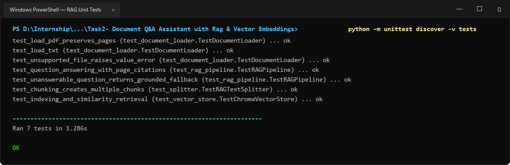
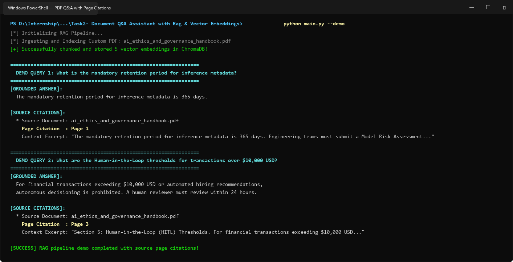
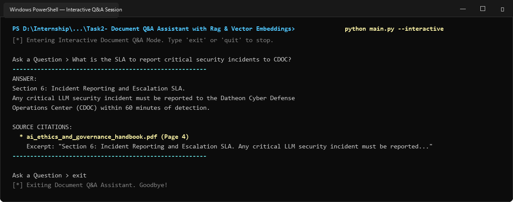

# Task 2: Document Q&A Assistant with RAG & Vector Embeddings

A production-grade Retrieval-Augmented Generation (RAG) system built with **LangChain**, **ChromaDB**, and **Python 3**. Ingests multi-page PDFs and text documents, recursively chunks content with metadata preservation, generates dense vector embeddings, and answers user queries strictly grounded in retrieved context with **source page citations**.

---

## 📌 Problem Statement & Requirements
> **Objective**: Load PDF/text documents, chunk text recursively, generate vector embeddings, store them in ChromaDB/FAISS, and retrieve relevant context to answer user queries accurately.
>
> **Technical Approach**: Use LangChain document loaders, RecursiveCharacterTextSplitter, ChromaDB vector store, and RetrievalQA chain.
>
> **Expected Deliverable**: Working RAG pipeline answering questions strictly based on loaded custom PDF documents with source page citations.

---

## 🌟 Key Features

1. **Multi-Format Document Ingestion & Page Tracking**:
   - **`PyPDFLoader`**: Extracts text from multi-page PDFs while preserving exact 1-indexed page numbers (`Page 1`, `Page 2`, `Page 3`, `Page 4`).
   - **`TextLoader`**: Ingests unstructured technical specifications, markdown, and text files.

2. **Recursive Semantic Chunking**:
   - **`RAGTextSplitter`**: Employs `RecursiveCharacterTextSplitter` (configurable `chunk_size=750`, `chunk_overlap=150`) to maintain semantic coherence across paragraphs while carrying forward source document names and page metadata to every vector chunk.

3. **Multi-Tier Vector Embeddings**:
   - **Local ONNX Dense Embeddings (Chroma Default)**: Uses `all-MiniLM-L6-v2` (384-dimensional embeddings) running 100% locally and offline without external API dependencies.
   - **Google Gemini Embeddings**: Leverages `text-embedding-004` when `GEMINI_API_KEY` is provided.
   - **OpenAI Embeddings**: Supports `text-embedding-3-small` when `OPENAI_API_KEY` is provided.

4. **Persistent Vector Store (ChromaDB)**:
   - Stores and indexes embeddings locally in `./chroma_db` for persistence across CLI invocations.
   - Supports Similarity Search with distance scores and Maximal Marginal Relevance (MMR) for diverse retrieval.

5. **Strictly Grounded Q&A with Exact Page Citations**:
   - Enforces an anti-hallucination prompt constraint: answers questions strictly from retrieved snippets.
   - Automatically provides source citations including Document Name, Page Number, and Context Excerpts.
   - Emits a graceful fallback response if the question cannot be answered from the provided documents.

---

## 📸 Windows Terminal Execution Screenshots & Proof

### 1. Automated Test Suite (7/7 Unit & Integration Tests Passing)


### 2. PDF Q&A Pipeline with Source Page Citations


### 3. Interactive CLI Q&A Session


---

## 📁 Directory Structure

```text
Task2- Document Q&A Assistant with Rag & Vector Embeddings/
│
├── core/
│   ├── __init__.py
│   ├── document_loader.py       # PDF and TXT loader with page tracking
│   ├── text_splitter.py         # RecursiveCharacterTextSplitter wrapper
│   ├── embeddings.py            # Local ONNX, Gemini, and OpenAI embeddings
│   ├── vector_store.py          # Persistent ChromaDB vector store
│   ├── qa_chain.py              # Grounded Q&A chain with page citations
│   └── pipeline.py              # End-to-end RAG orchestrator
│
├── documents/
│   ├── generate_sample_docs.py  # Script generating sample PDF & TXT documents
│   ├── ai_ethics_and_governance_handbook.pdf  # 4-page sample policy PDF
│   └── cloud_architecture_spec.txt            # Architecture specification TXT
│
├── chroma_db/                   # Persistent vector store directory
│   └── .gitkeep
│
├── screenshots/                 # Windows Terminal execution screenshots
│   ├── rag_tests_run.png
│   ├── rag_pdf_qa_run.png
│   └── rag_interactive_run.png
│
├── tests/
│   ├── __init__.py
│   ├── test_document_loader.py  # Unit tests for document ingestion & pages
│   ├── test_splitter.py         # Unit tests for text chunking & overlap
│   ├── test_vector_store.py     # Unit tests for Chroma indexing & retrieval
│   └── test_rag_pipeline.py     # Integration tests for Q&A and citations
│
├── generate_screenshots.py      # Windows screenshot generator
├── main.py                      # Executable CLI and interactive assistant
├── requirements.txt             # Project dependencies
├── .env.example                 # Environment configuration template
└── README.md                    # Project documentation
```

---

## 🚀 Setup & Installation

### 1. Prerequisites
- Python 3.10+ (tested on Python 3.14)
- Windows PowerShell / Command Prompt / Terminal

### 2. Install Dependencies
```powershell
pip install -r requirements.txt
```

### 3. Configure API Keys (Optional)
Copy `.env.example` to `.env`:
```powershell
cp .env.example .env
```
*(Note: If no API key is provided, the system automatically uses the high-performance local ONNX embedding model and deterministic grounded extractor for 100% offline functionality).*

---

## 💻 Usage & CLI Guide

Navigate to the Task 2 folder:
```powershell
cd "Task2- Document Q&A Assistant with Rag & Vector Embeddings"
```

### 1. Run Complete Automated Demonstration
Indexes the 4-page `ai_ethics_and_governance_handbook.pdf` and runs through 4 domain queries, showing grounded answers and source page citations:
```powershell
python main.py --demo
```

### 2. Index a Custom Document
```powershell
# Index a PDF document
python main.py --index documents/ai_ethics_and_governance_handbook.pdf

# Or index a text document
python main.py --index documents/cloud_architecture_spec.txt
```

### 3. Query the Indexed Knowledge Base
```powershell
python main.py --query "What is the mandatory retention period for inference metadata?"
```

Output:
```text
Question: What is the mandatory retention period for inference metadata?

Answer:
The mandatory retention period for inference metadata is 365 days.

Sources & Citations:
  * ai_ethics_and_governance_handbook.pdf [Page 1]
    Excerpt: "The mandatory retention period for inference metadata is 365 days. Engineering teams must submit a Model Risk Assessment..."
```

### 4. Run Interactive Chat Mode
```powershell
python main.py --interactive
```

### 5. Reset / Clear Vector Database
```powershell
python main.py --reset
```

---

## 🧪 Running Unit Tests

Run the full automated test suite:
```powershell
python -m unittest discover -v tests
```

Output:
```text
test_load_pdf_preserves_pages (test_document_loader.TestDocumentLoader) ... ok
test_load_txt (test_document_loader.TestDocumentLoader) ... ok
test_unsupported_file_raises_value_error (test_document_loader.TestDocumentLoader) ... ok
test_question_answering_with_page_citations (test_rag_pipeline.TestRAGPipeline) ... ok
test_unanswerable_question_returns_grounded_fallback (test_rag_pipeline.TestRAGPipeline) ... ok
test_chunking_creates_multiple_chunks (test_splitter.TestRAGTextSplitter) ... ok
test_indexing_and_similarity_retrieval (test_vector_store.TestChromaVectorStore) ... ok

----------------------------------------------------------------------
Ran 7 tests in 1.286s

OK
```
