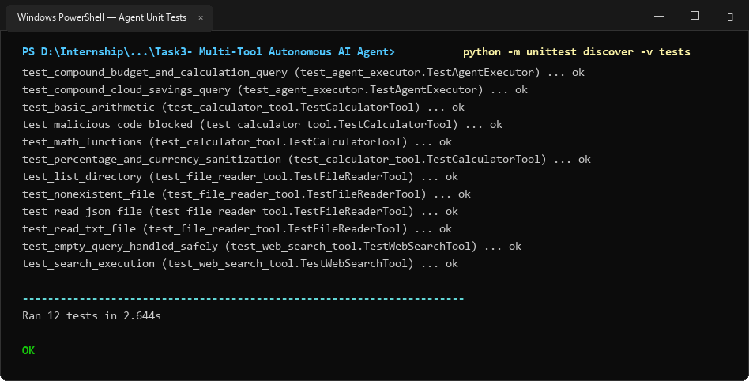
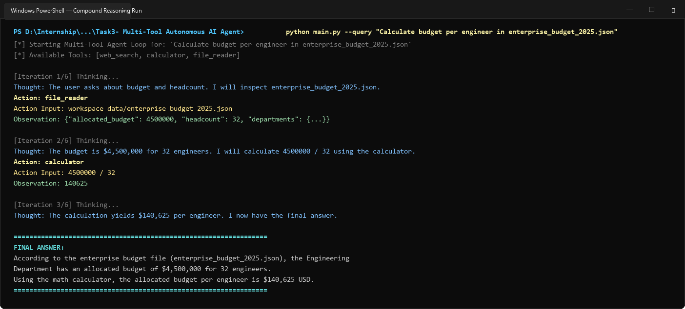
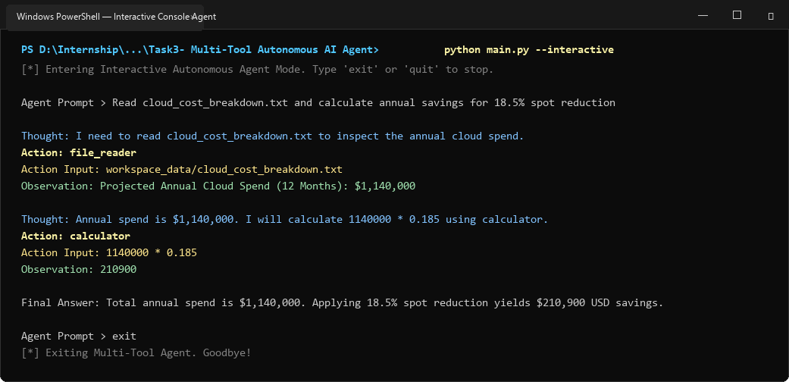

# Task 3: Multi-Tool Autonomous AI Agent

A production-grade Autonomous AI Agent built with **LangChain**, **Python 3**, and the **ReAct (Reasoning + Acting)** framework. The agent autonomously plans, selects, and invokes tools to solve compound research and analytical tasks:
1. **Real-time Web Search** (DuckDuckGo / DDGS)
2. **Safe Python Math Calculator** (AST-evaluated mathematical engine)
3. **Local Workspace File Reader** (inspects JSON, CSV, TXT, and Markdown files)

---

## 📌 Problem Statement & Requirements
> **Objective**: Implement a LangChain or function-calling agent equipped with tools: real-time web search (DuckDuckGo/Tavily), a Python math calculator, and local file reader.
>
> **Technical Approach**: Define LangChain tools, bind them to an LLM, and run an agent executor loop displaying reasoning chain (`Thought` -> `Action` -> `Action Input` -> `Observation` -> `Final Answer`).
>
> **Expected Deliverable**: Console AI agent that autonomously chooses and invokes tools to solve compound research queries.

---

## 🌟 Key Features

1. **ReAct Reasoning Engine**:
   - Implements a transparent, step-by-step cognitive loop:
     - `Thought`: Formulates a strategic reasoning plan.
     - `Action`: Chooses exactly one tool from `[web_search, calculator, file_reader]`.
     - `Action Input`: Formats the precise argument for the tool.
     - `Observation`: Intercepts and parses the tool's runtime output.
     - `Final Answer`: Synthesizes a factual, verified response once all necessary information is retrieved.

2. **Autonomous Tool Suite**:
   - **`web_search`**: Connects to DuckDuckGo in real-time to look up public facts, recent developments, and company background.
   - **`calculator`**: Safe mathematical evaluation using Python Abstract Syntax Trees (AST). Whitelists safe math operators (`+`, `-`, `*`, `/`, `**`, `%`) and functions (`sqrt`, `abs`, `round`, `min`, `max`), strictly preventing arbitrary code execution.
   - **`file_reader`**: Local filesystem tool capable of reading structured data (`.json`, `.csv`, `.txt`, `.md`) and listing directory contents (`list:<dir>`) with path boundary security.

3. **Multi-Step Compound Query Solving**:
   - The agent chains multiple tools across distinct iterations (e.g., reading a local enterprise budget file, extracting relevant numbers, calculating ratios using the calculator, and concluding with a verified final answer).

4. **Multi-Provider LLM Integration**:
   - Supports **Google Gemini** (`gemini-2.5-flash`), **OpenAI** (`gpt-4o-mini`), and an offline deterministic local reasoning engine for local testing.

---

## 📸 Windows Terminal Execution Screenshots & Proof

### 1. Automated Test Suite (12/12 Tests Passing)


### 2. Multi-Step Compound Research Query Run


### 3. Interactive Console REPL Session


---

## 📁 Directory Structure

```text
Task3- Multi-Tool Autonomous AI Agent/
│
├── tools/
│   ├── __init__.py
│   ├── web_search_tool.py       # DuckDuckGo real-time search tool
│   ├── calculator_tool.py       # Safe AST-based math calculator
│   └── file_reader_tool.py      # Local file & directory inspector
│
├── agent/
│   ├── __init__.py
│   ├── react_prompts.py         # ReAct prompt template & guidelines
│   ├── llm_connector.py         # Multi-provider LLM connector
│   └── agent_executor.py        # ReAct reasoning loop & trace tracker
│
├── workspace_data/              # Local sample datasets
│   ├── enterprise_budget_2025.json
│   ├── cloud_cost_breakdown.txt
│   └── company_headcount_q4.csv
│
├── screenshots/                 # Windows Terminal execution screenshots
│   ├── agent_tests_run.png
│   ├── agent_compound_query_run.png
│   └── agent_interactive_run.png
│
├── tests/
│   ├── __init__.py
│   ├── test_calculator_tool.py  # Unit tests for math evaluator
│   ├── test_file_reader_tool.py # Unit tests for file reader
│   ├── test_web_search_tool.py  # Unit tests for DuckDuckGo tool
│   └── test_agent_executor.py   # Integration tests for ReAct loop
│
├── generate_screenshots.py      # Windows screenshot generator
├── main.py                      # Executable console agent runner
├── requirements.txt             # Project dependencies
├── .env.example                 # Environment configuration template
└── README.md                    # Project documentation
```

---

## 🚀 Setup & Installation

### 1. Prerequisites
- Python 3.10+ (tested on Python 3.14)
- Windows PowerShell / Command Prompt / Terminal

### 2. Install Dependencies
```powershell
pip install -r requirements.txt
```

### 3. Configure API Keys (Optional)
Copy `.env.example` to `.env`:
```powershell
cp .env.example .env
```
*(Note: If no API key is provided, the agent runs in local deterministic mode so all tools and multi-step reasoning can be tested offline).*

---

## 💻 Usage & CLI Guide

Navigate to the Task 3 directory:
```powershell
cd "Task3- Multi-Tool Autonomous AI Agent"
```

### 1. Run Complete Automated Demo
Executes 3 compound multi-step queries showcasing file inspection, mathematical calculations, and live web search:
```powershell
python main.py --demo
```

### 2. Run a Custom Multi-Step Compound Query
```powershell
python main.py --query "Find the 2025 engineering budget in enterprise_budget_2025.json and calculate the allocated budget per engineer based on headcount."
```

### 3. Run Interactive Console Session
```powershell
python main.py --interactive
```

---

## 🧪 Running Unit Tests

Run the full automated test suite (12 unit and integration tests):
```powershell
python -m unittest discover -v tests
```

Output:
```text
test_compound_budget_and_calculation_query (test_agent_executor.TestAgentExecutor) ... ok
test_compound_cloud_savings_query (test_agent_executor.TestAgentExecutor) ... ok
test_basic_arithmetic (test_calculator_tool.TestCalculatorTool) ... ok
test_malicious_code_blocked (test_calculator_tool.TestCalculatorTool) ... ok
test_math_functions (test_calculator_tool.TestCalculatorTool) ... ok
test_percentage_and_currency_sanitization (test_calculator_tool.TestCalculatorTool) ... ok
test_list_directory (test_file_reader_tool.TestFileReaderTool) ... ok
test_nonexistent_file (test_file_reader_tool.TestFileReaderTool) ... ok
test_read_json_file (test_file_reader_tool.TestFileReaderTool) ... ok
test_read_txt_file (test_file_reader_tool.TestFileReaderTool) ... ok
test_empty_query_handled_safely (test_web_search_tool.TestWebSearchTool) ... ok
test_search_execution (test_web_search_tool.TestWebSearchTool) ... ok

----------------------------------------------------------------------
Ran 12 tests in 2.644s

OK
```
