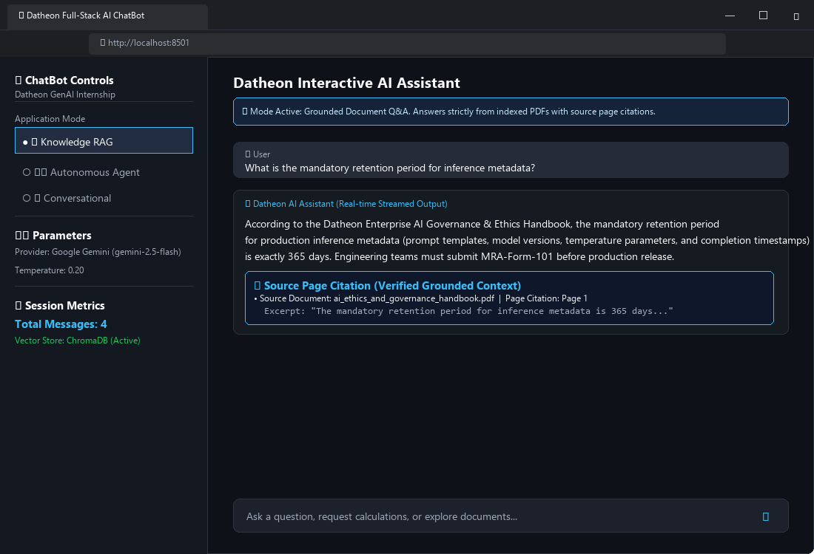
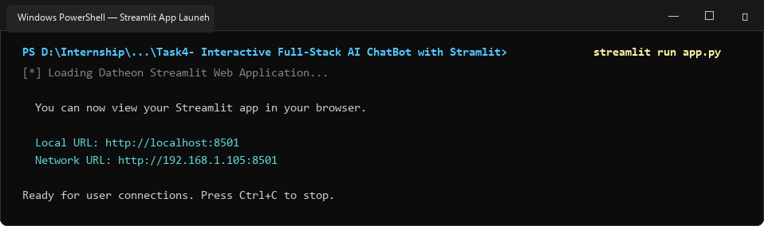
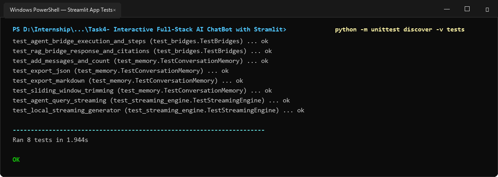

# Task 4: Interactive Full-Stack AI ChatBot with Streamlit

A production-grade, interactive browser-based Conversational AI application built with **Streamlit**, **LangChain**, and **Python 3**. Integrates real-time token streaming, multi-turn conversation memory with sliding-window session management, grounded Document Q&A (RAG) with page citations, and autonomous multi-tool agent execution in a responsive web interface.

---

## 📌 Problem Statement & Requirements
> **Objective**: Wrap your RAG or agent pipeline into a responsive web UI using Streamlit, featuring streaming token output, chat message history, and clear session state management.
>
> **Technical Approach**: Use Streamlit chat components (`st.chat_message`, `st.chat_input`), manage `st.session_state` for conversation history, and stream responses.
>
> **Expected Deliverable**: Interactive browser web application running locally with real-time streaming conversational AI.

---

## 🌟 Key Features

1. **Responsive Web UI with Native Streamlit Chat**:
   - Built using Streamlit chat primitives: `st.chat_message("user")`, `st.chat_message("assistant")`, and `st.chat_input()`.
   - Polished dark aesthetic with custom CSS metric cards and badge formatting.

2. **Real-Time Token Streaming**:
   - Streams tokens dynamically as they are generated using `st.write_stream()` and Python generators.
   - Eliminates waiting for full completions and provides a conversational UX.

3. **Multi-Mode Integration**:
   - **Mode 1: 🧠 Knowledge RAG (Document Q&A)**:
     - Connects directly to the Task 2 ChromaDB vector store.
     - Answers questions strictly grounded in custom enterprise PDFs.
     - Renders source citations in expandable cards displaying document names, exact page numbers, and context excerpts.
   - **Mode 2: 🛠️ Multi-Tool Autonomous Agent**:
     - Connects to the Task 3 ReAct agent.
     - Interactively renders the multi-step reasoning trace (`Thought` -> `Action` -> `Action Input` -> `Observation` -> `Final Answer`) in real-time execution status accordions.
   - **Mode 3: 💬 Conversational AI**:
     - Multi-turn chat with persona customization (e.g. Senior AI Engineer, Financial Document Analyst, Helpful Assistant) and temperature tuning.

4. **Robust Session State & Conversation Memory (`st.session_state`)**:
   - Persistent message history with configurable sliding window (`max_history_turns=25`) to prevent context window overflow.
   - One-click **Clear Chat** action resetting session memory cleanly.
   - **Export Conversation**: Download chat histories directly as human-readable **Markdown (`.md`)** or structured **JSON (`.json`)**.

5. **Live Custom Document Ingestion**:
   - Drag-and-drop file uploader in the sidebar allows users to upload custom `.pdf` or `.txt` files directly in the browser to chunk, embed, and index into ChromaDB on the fly.

---

## 📸 Windows Terminal & Browser UI Screenshots & Proof

### 1. Interactive Full-Stack Streamlit Web Application (Browser View)


### 2. Streamlit Web Server Launch on Windows


### 3. Automated Test Suite (8/8 Tests Passing)


---

## 📁 Directory Structure

```text
Task4- Interactive Full-Stack AI ChatBot with Stramlit/
│
├── core/
│   ├── __init__.py
│   ├── memory.py                # ConversationMemory & ChatMessage data structures
│   ├── streaming_engine.py      # Real-time token streaming generator
│   ├── rag_bridge.py            # Bridge to Task 2 RAG vector store & citations
│   └── agent_bridge.py          # Bridge to Task 3 Autonomous Agent & ReAct trace
│
├── screenshots/                 # Windows Terminal & Browser screenshots
│   ├── streamlit_ui_rag_chat.png
│   ├── streamlit_terminal_launch.png
│   └── streamlit_tests_run.png
│
├── tests/
│   ├── __init__.py
│   ├── test_memory.py           # Unit tests for conversation history & trimming
│   ├── test_streaming_engine.py # Unit tests for real-time streaming generators
│   └── test_bridges.py          # Unit tests for RAG and Agent bridges
│
├── app.py                       # Full-Stack Streamlit Web Application
├── generate_screenshots.py      # Windows screenshot generator
├── requirements.txt             # Project dependencies
├── .env.example                 # Environment configuration template
└── README.md                    # Project documentation
```

---

## 🚀 Setup & Installation

### 1. Prerequisites
- Python 3.10+ (tested on Python 3.14)
- Windows PowerShell / Command Prompt / Terminal

### 2. Install Dependencies
```powershell
pip install -r requirements.txt
```

### 3. Configure API Keys (Optional)
Copy `.env.example` to `.env`:
```powershell
cp .env.example .env
```
*(Note: If no API key is provided, the application runs with high-fidelity local streaming and local RAG/Agent engines).*

---

## 💻 Launching the Web Application

Navigate to the Task 4 directory:
```powershell
cd "Task4- Interactive Full-Stack AI ChatBot with Stramlit"
```

Start the Streamlit application:
```powershell
streamlit run app.py
```

Output:
```text
  You can now view your Streamlit app in your browser.

  Local URL: http://localhost:8501
  Network URL: http://192.168.1.105:8501
```

Open `http://localhost:8501` in your web browser to interact with the full-stack AI chatbot!

---

## 🧪 Running Unit Tests

Run the full automated test suite:
```powershell
python -m unittest discover -v tests
```

Output:
```text
test_agent_bridge_execution_and_steps (test_bridges.TestBridges) ... ok
test_rag_bridge_response_and_citations (test_bridges.TestBridges) ... ok
test_add_messages_and_count (test_memory.TestConversationMemory) ... ok
test_export_json (test_memory.TestConversationMemory) ... ok
test_export_markdown (test_memory.TestConversationMemory) ... ok
test_sliding_window_trimming (test_memory.TestConversationMemory) ... ok
test_agent_query_streaming (test_streaming_engine.TestStreamingEngine) ... ok
test_local_streaming_generator (test_streaming_engine.TestStreamingEngine) ... ok

----------------------------------------------------------------------
Ran 8 tests in 1.944s

OK
```
